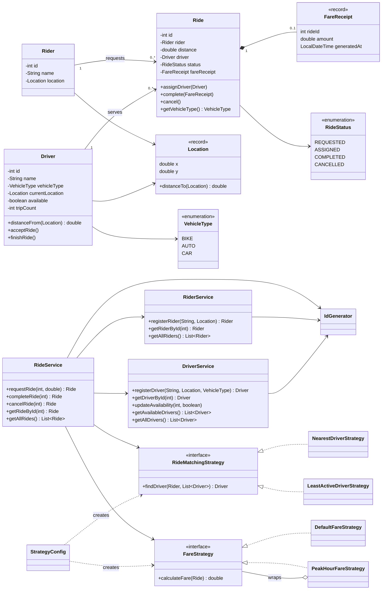

# RideWise: Class Model

This diagram shows the main classes in the project and how they relate to each other.

## Layers in the project

| Layer | Package | Responsibility |
|-------|---------|----------------|
| UI | `Main` and `Main.Menu` | Read input, call services, show results |
| Service | `service` | Core use cases such as register, list, request, complete, and cancel |
| Strategy | `strategy` | Driver matching and fare calculation logic |
| Model | `model` | Domain objects and rules like ride lifecycle and driver availability |
| Config | `config` | Selects which strategy implementations to use |
| Support | `exception`, `util` | Exceptions and ID generation |

The main direction of dependency is simple:

UI -> Service -> Strategy / Model

The model does not depend on services. This keeps the code easier to test and easier to extend.
